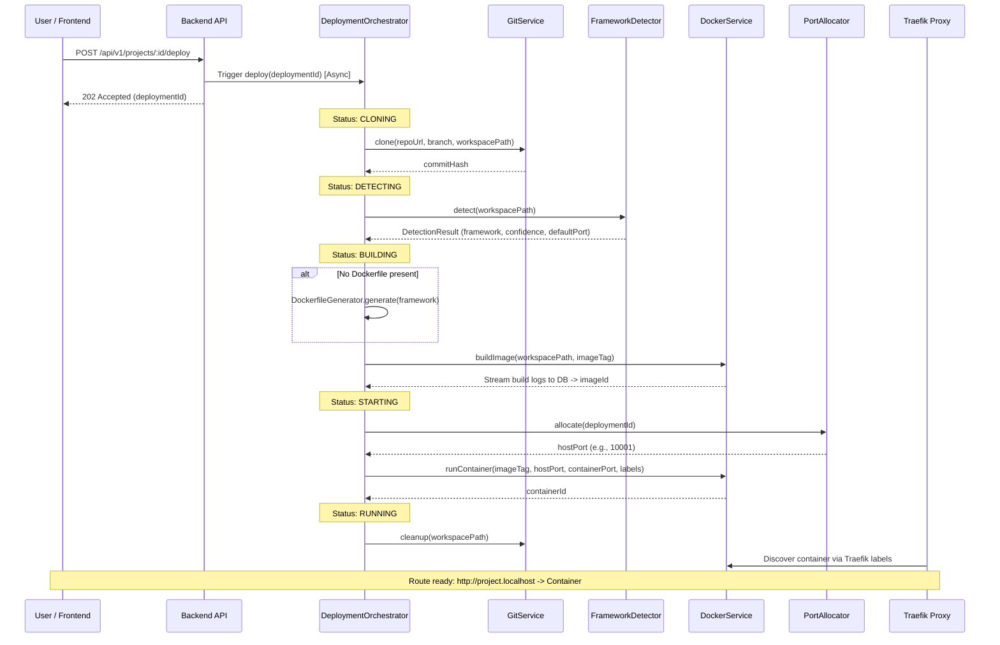

# RYME Architecture & Engineering Design

> **Status: superseded.** This document describes the platform as it existed before the
> PULSE rebrand. It is retained as a historical design record; the current target
> architecture is [`docs/pulse/PULSE-02-target-architecture.md`](pulse/PULSE-02-target-architecture.md).
> Legacy identifiers below (`ryme-network`, `ryme-*` container names) describe the state at
> the time of writing and are preserved deliberately — see `PULSE-15` section 4.

This document outlines the architectural decisions, system design, and engineering principles behind **RYME**, a self-hosted open-source deployment platform.

---

## 1. Executive Summary & Design Philosophy

RYME is built to replicate the core deployment mechanics of modern PaaS platforms (Vercel, Railway, Render, Fly.io, Coolify, Dokploy) while maintaining strict simplicity, security, and reliability.

### Core Principles
1. **No Shortcuts & Production Quality**: Every component uses industry-standard patterns (multi-stage Docker builds, strict TypeScript, Zod schema validation, structured JSON logging).
2. **Fail-Fast Configuration**: The application validates all required environment variables at startup using Zod. Missing configuration crashes immediately with clear error messages rather than failing unpredictably at runtime.
3. **Defense in Depth (Security First)**:
   - Zero reliance on raw shell commands (`exec`, `spawn`, `child_process`) for Git or Docker operations. All interactions go through typed SDKs (`simple-git`, `dockerode`).
   - Strict URL validation preventing SSRF, local file access, and SSH-based vector attacks.
   - Strict path traversal prevention ensuring repositories cannot clone outside workspace boundaries.
   - Isolation via Docker bridge networks with Traefik `exposedByDefault=false`.
4. **Separation of Concerns**: Clean layered architecture separating HTTP routing, request validation, business logic, and database access.

---

## 2. System Architecture

RYME operates as a modular monorepo orchestrated via `pnpm workspaces`:

```mermaid
graph TD
    User[User / Browser] -->|HTTP :5173| FE[Frontend React Dashboard]
    FE -->|REST API :3001| BE[Backend Express Server]
    User -->|Wildcard HTTP :80| Traefik[Traefik Reverse Proxy]
    Traefik -->|Docker Bridge Network| Containers[Deployed Application Containers]
    
    subgraph RYME Monorepo
        BE -->|Imports| Shared[@ryme/shared - Zod Schemas / Types]
        BE -->|Imports| DB[@ryme/db - Prisma ORM Singleton]
        FE -->|Imports| Shared
    end
    
    subgraph Infrastructure
        BE -->|Unix Socket /var/run/docker.sock| Docker[Docker Engine]
        BE -->|TCP :5432| Postgres[(PostgreSQL Database)]
        Docker -->|Manages| Traefik
        Docker -->|Manages| Containers
    end
```

---

## 3. The Deployment Pipeline

When a user triggers a deployment, `DeploymentOrchestrator` executes an asynchronous background state machine tracked in PostgreSQL:



---

## 4. Framework Detection Engine

The `FrameworkDetector` evaluates cloned repository contents in a strict priority order to prevent misclassification (e.g., distinguishing Next.js from React or Express from generic Node.js):

1. **Custom Dockerfile**: If `Dockerfile` exists at root, use `custom` framework with confidence `1.0`.
2. **Node.js (`package.json`)**:
   - Check `dependencies` / `devDependencies` for `next` → **Next.js** (0.95)
   - Check for `react` / `react-dom` → **React** (0.90)
   - Check for `express` → **Express** (0.90)
   - Fallback → **Node.js** (0.70)
3. **Python (`requirements.txt` / `pyproject.toml`)**:
   - Check for `fastapi` → **FastAPI** (0.90)
   - Check for `flask` → **Flask** (0.90)
   - Check for `django` → **Django** (0.90)
4. **JVM (`pom.xml` / `build.gradle` / `build.gradle.kts`)** → **Spring Boot** (0.80)
5. **Go (`go.mod`)** → **Go** (0.90)
6. **Rust (`Cargo.toml`)** → **Rust** (0.90)
7. **Static HTML (`index.html` without `package.json`)** → **Static HTML** (0.60)

---

## 5. Network & Dynamic Routing Architecture

To avoid manual Nginx reloads or port forwarding configuration, RYME leverages **Traefik** with Docker service discovery:

- **Isolated Bridge Network**: All application containers and Traefik reside on `ryme-network`.
- **No Host Port Collisions**: Containers bind to host ports from an allocated pool (`10000-65000`) for debugging, but Traefik routes traffic directly to internal container ports over the Docker network.
- **Dynamic Container Labels**: When `DockerService` launches a container, it attaches:
  ```json
  {
    "traefik.enable": "true",
    "traefik.http.routers.my-project.rule": "Host(`my-project.localhost`)",
    "traefik.http.routers.my-project.entrypoints": "web",
    "traefik.http.services.my-project.loadbalancer.server.port": "3000"
  }
  ```

---

## 6. Security & Error Handling

### SDKs Over Shell Commands
A common vulnerability in PaaS implementations is command injection via repository names or branch strings passed to `exec("git clone " + url)`. RYME prevents this entirely by using `simple-git` and `dockerode`, which invoke underlying system APIs with parameterized argument arrays.

### Consistent API Error Envelope
All API responses follow a strict envelope format:
```json
{
  "success": false,
  "error": {
    "code": "VALIDATION_ERROR",
    "message": "Validation failed",
    "statusCode": 400,
    "details": [{ "field": "repositoryUrl", "message": "Invalid URL" }]
  },
  "meta": { "timestamp": "2026-07-04T12:00:00.000Z" }
}
```
Operational errors (e.g., `NotFoundError`, `GitError`, `DockerError`) are safely exposed to clients, while unexpected programming errors are logged with stack traces via `pino` and masked as generic 500 errors to prevent information leakage.
